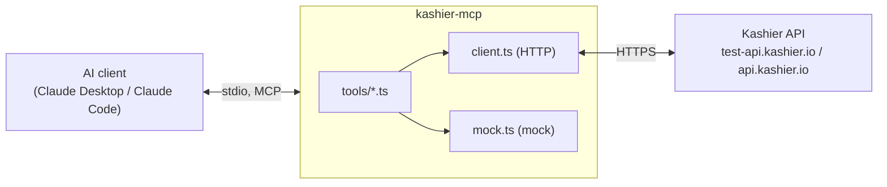

# kashier-mcp

> **UNOFFICIAL.** This project is not affiliated with, endorsed by, or sponsored by Kashier. It uses no Kashier logos or branding. "Kashier" is a trademark of its owner.

An MCP (Model Context Protocol) server that lets AI clients such as Claude Desktop and Claude Code work with the [Kashier](https://kashier.io) payment gateway (Egypt). Create payment links, check payment status, review transactions and sales, and issue refunds through natural conversation. It defaults to Kashier's test environment, and a built-in mock mode runs with no keys at all.

## Architecture



## Tools

| Tool | What it does | Endpoint |
|---|---|---|
| `create_payment_link` | Creates a hosted checkout link (amount in EGP, order reference, customer email, optional phone/reference/description, `expiresInHours` default 24) | `POST /v3/payment/sessions` |
| `get_payment_status` | By `sessionId` or `orderReference`: paid / pending / failed, amount, timestamp | `GET /v3/payment/sessions/{id}/payment`, `GET /v3/payment/orders?search=` |
| `list_transactions` | Transactions in a `from`/`to` date range (YYYY-MM-DD), filter by `status`, `type`, `limit` | `GET /v2/aggregator/transactions` |
| `sales_summary` | Total paid, count, average order value, failed count for a date range | `GET /v2/aggregator/transactions` |
| `refund_payment` | Full or partial refund; preview first, then `confirm: true` to execute | `GET /v2/aggregator/transactions/{id}`, `PUT /v3/payment/refund/{orderId}` |

All calls go to the management host (`test-api.kashier.io` in test, `api.kashier.io` in live). Customers pay on Kashier's hosted checkout (`payments.kashier.io`).

## Setup

Requires Node 20+.

```bash
git clone <this-repo-url> kashier-mcp
cd kashier-mcp
npm install
npm run build
cp .env.example .env
```

## Environment variables

| Variable | Description |
|---|---|
| `KASHIER_MODE` | `mock` (no network, no keys), `test` (default), or `live` |
| `KASHIER_SECRET_KEY` | Sent raw as the `Authorization` header |
| `KASHIER_API_KEY` | Payment API key, sent as `api-key` header only when creating payment sessions |
| `KASHIER_MERCHANT_ID` | Merchant id, format `MID-xxx-xxx` |
| `KASHIER_MERCHANT_REDIRECT` | URL Kashier redirects customers to after paying (required by the sessions API) |
| `KASHIER_ALLOW_LIVE` | Must be `true` or the server refuses to start in `live` mode |

Mock mode needs none of the keys.

## Connect to an AI client

### Claude Desktop

Edit the config file:

- Windows: `%APPDATA%\Claude\claude_desktop_config.json`
- macOS: `~/Library/Application Support/Claude/claude_desktop_config.json`

Claude Desktop does not read `.env`, so env vars go in the `env` block. Use an absolute path.

Mock mode (no keys):

```json
{
  "mcpServers": {
    "kashier": {
      "command": "node",
      "args": ["<absolute path>/kashier-mcp/dist/index.js"],
      "env": { "KASHIER_MODE": "mock" }
    }
  }
}
```

Test mode with keys:

```json
{
  "mcpServers": {
    "kashier": {
      "command": "node",
      "args": ["<absolute path>/kashier-mcp/dist/index.js"],
      "env": {
        "KASHIER_MODE": "test",
        "KASHIER_SECRET_KEY": "your-test-secret-key",
        "KASHIER_API_KEY": "your-test-payment-api-key",
        "KASHIER_MERCHANT_ID": "MID-000-000",
        "KASHIER_MERCHANT_REDIRECT": "https://example.com/payment/done"
      }
    }
  }
}
```

Restart Claude Desktop after editing.

### Claude Code

```bash
claude mcp add kashier -e KASHIER_MODE=mock -- node /abs/path/dist/index.js
```

## Try it in mock mode

```bash
npm run build
KASHIER_MODE=mock npm run inspect   # PowerShell: $env:KASHIER_MODE="mock"; npm run inspect
```

The MCP Inspector opens in your browser; call any tool against the built-in mock data.

## Example conversations

**Create a payment link**

> **User:** Make a payment link for 450 EGP, order ORD-1042, for sara@example.com.
> **Assistant:** *(calls `create_payment_link`)* Done. Link for 450.00 EGP, order ORD-1042, valid 24 hours: `https://payments.kashier.io/...`

**Check a payment**

> **User:** Did order ORD-1042 get paid?
> **Assistant:** *(calls `get_payment_status` with `orderReference`)* Yes. Status: paid, 450.00 EGP, at 2026-10-22 14:03 UTC.

**List transactions**

> **User:** Show failed payments from 1 to 7 October.
> **Assistant:** *(calls `list_transactions` with `from`, `to`, `status`)* 3 rejected transactions in that range: ORD-1011 (200.00 EGP), ORD-1015 (99.00 EGP), ORD-1019 (1,250.00 EGP).

**Sales summary**

> **User:** How did October go so far?
> **Assistant:** *(calls `sales_summary`)* Paid total 48,320.00 EGP across 112 orders, average order value 431.43 EGP, 9 failed.

**Refund (preview, then confirm)**

> **User:** Refund 100 EGP of transaction TX-88213.
> **Assistant:** *(calls `refund_payment`, `confirm` false)* Preview only, nothing was refunded: 100.00 EGP of the original 450.00 EGP on order ORD-1042. Confirm?
> **User:** Yes.
> **Assistant:** *(calls `refund_payment`, `confirm: true`)* Refund processed: 100.00 EGP.

## Safety design

- **Test mode by default.** Nothing touches real money unless you opt in.
- **Live-mode guard.** `KASHIER_MODE=live` refuses to start unless `KASHIER_ALLOW_LIVE=true`.
- **Two-step refunds.** Without `confirm: true`, `refund_payment` returns a preview only.
- **Read before refund.** The transaction is looked up first, and the amount is validated to be at most the original.
- **Secrets never logged or returned** in tool output or errors.
- **Friendly error mapping:** 401 (wrong key, wrong mode, or missing permission), 403 (IP allow-list), 404 (not found), 400 (validation).
- **stdout is reserved for MCP.** Diagnostics go to stderr.

## Testing

```bash
npm test
```

Runs vitest against the mock client; no network or keys needed.

## Limitations

- **Date filtering is client-side.** Kashier's transactions endpoint has no date filter, so the server sorts by date descending and filters locally, scanning up to 10 pages of 100. Results beyond that are flagged `truncated`.
- Kashier gates features per merchant and per role permission. A refund requires the refund permission on your key.
- Live refunds move real money.

## Roadmap

- Bosta shipping tools (create a shipment after payment)
- WhatsApp notifications (send payment link / receipt)
- Webhook listener

## License

MIT
